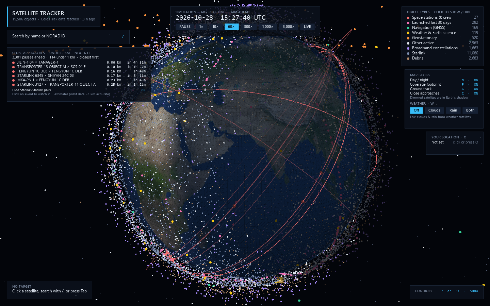
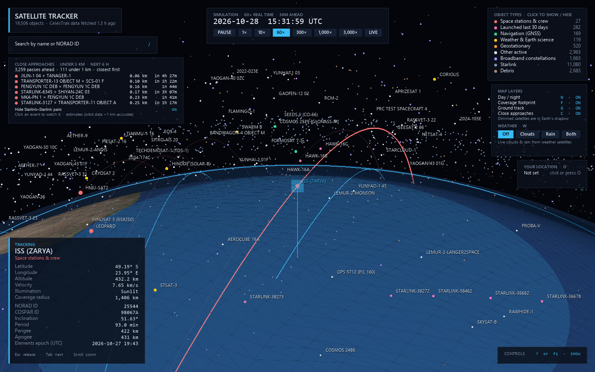

# Satellite Tracker

A 3D satellite tracker built with PyVista. It shows about 19,500 objects from CelesTrak (active satellites, launches from the last 30 days, and the major debris clouds) moving over a rotating Earth, propagated with SGP4 on a simulation clock you can speed up, pause or set back to real time. Set your location and it tells you when a satellite passes overhead and whether you'll be able to see it.



## Features

- **The whole catalog, live:** about 19,500 objects colour-coded by type (stations, recent launches, navigation, weather and science, geostationary, broadband constellations, Starlink, debris). Each type can be shown or hidden.
- **Track any object:** click it, or search by name or NORAD ID, and a chase camera follows it. The tracking card shows its position, altitude, speed, orbit and whether it's in sunlight.
- **Passes over your location:** set your location by city name or coordinates, and see when the tracked satellite passes over you in the next 10 days, which direction it comes from, how high it climbs, and whether the pass is visible to the naked eye. Click a pass to watch it.
- **Coverage footprint and ground track:** the area the tracked satellite covers on the ground, and where it will pass over the next 3 orbits.
- **Close-approach screening:** every pass under 5 km between any two objects in the next 6 hours, closest first, computed in a background process. Click one to jump the clock there and watch it.
- **Day/night shading:** the night side of the Earth is shaded and satellites in Earth's shadow are dimmed.
- **Weather overlay:** live global clouds (EUMETSAT) and precipitation (NASA IMERG).
- **Simulation clock:** from real time up to 3,000× faster, with a LIVE button to return to the current time.
- **Clean view:** hide the whole interface with U and keep just the globe, satellites and labels.
- **Sharp on high-DPI screens**, with the window sized to fit your display.



## Getting started

You need **Python 3.13** (see [Troubleshooting](#troubleshooting) for why not 3.14).

Windows:

```
py -3.13 -m venv .venv
.venv\Scripts\activate
pip install -r requirements.txt
python main.py
```

macOS / Linux:

```
python3.13 -m venv .venv
source .venv/bin/activate
pip install -r requirements.txt
python main.py
```

The first start downloads the orbital data from CelesTrak, which takes a few seconds.

### Options

```
python main.py --groups stations visual # a lighter set (any CelesTrak group names)
python main.py --offline                # no downloads: use cached data, or the bundled stations.tle
python main.py --location 51.51 -0.13   # your location (latitude, longitude), saved for next time
python main.py --ui-scale 1.25          # text and controls size (default: your display scaling)
```

## Your location and passes

Press **O** (or click the Your Location panel) and type a city name or coordinates such as `51.51, -0.13`. City names are looked up with OpenStreetMap's Nominatim service; coordinates work offline. The location is saved in `settings.json` next to the app and shown as a white dot on the globe.

With a location set, the panel lists the tracked satellite's passes over the next 10 days in your local time: when it rises, the direction it rises and sets in, and how high it climbs. Passes marked **VISIBLE** are the ones you can see with the naked eye, because the satellite is in sunlight while your sky is dark. By default only visible passes are listed; click "Only visible passes" to see them all. Click a pass to jump the clock to a minute before it rises.

## Controls

| Action | Input |
| --- | --- |
| Track a satellite (chase camera) | Click it |
| Search by name or NORAD ID | `/` or Ctrl+F, then Up/Down and Enter |
| Next / previous satellite of the same type | Tab / Shift+Tab |
| Release target, home view | Esc or H |
| Pause / resume | Space |
| Simulation speed | Left / Right, or the speed buttons |
| Back to real time (live) | 0 or Home, or the LIVE button |
| Set your location | O, or click Your Location |
| Watch a pass | Click it in the Your Location panel |
| Watch a close approach | Click it in the Close Approaches panel |
| Labels | L |
| Day/night, footprint, ground track, close approaches | N, F, G, C (or click in Map Layers) |
| Weather overlay (Off / Clouds / Rain / Both) | W, or the weather buttons |
| Show / hide an object type | Click its legend row |
| Show / hide the controls list | ? or F1, or click CONTROLS |
| Hide / show the whole interface (satellites and labels stay) | U, or click Hide interface in Controls |
| Rotate / zoom | Drag / scroll |

## Data and caching

Orbital elements are downloaded in OMM (CSV) format, because new objects now have catalogue numbers too large for the older TLE format. They're cached in `tle_cache/` for 2 hours, since CelesTrak temporarily blocks clients that download the same data more often than that. Weather images are cached in `weather_cache/` for 30 minutes. Both folders and `settings.json` are git-ignored.

## Accuracy notes

- Orbital elements of this kind (TLE/OMM, propagated with SGP4) are good to roughly 1 km near their epoch, and worse for debris and as they age.
- Close approaches are screening estimates, not collision predictions. Starlink satellites manoeuvre on their own to avoid each other, which is why Starlink–Starlink pairs are hidden by default. Screening covers 6 hours and takes about 30 s, so at the fastest speeds it can't keep up.
- Pass times are accurate to a few seconds for the next day or two. Further out they can shift by minutes, because satellites like the ISS adjust their orbits and the elements age.
- The Sun's position uses a low-precision almanac formula, accurate to about 0.01°. That is plenty for day/night shading and pass visibility, which uses a 6° twilight margin.

## Troubleshooting

- **The app runs at about 2 FPS.** You're probably on Python 3.14: sgp4 has no compiled build for it on Windows yet, so pip installs a pure-Python version that is about 30× slower. The app prints a warning at startup when this happens. Use Python 3.13.
- **Satellites are drawn as small squares instead of round dots.** Some graphics drivers can't draw VTK's round points at all, so the app detects this at startup and falls back to squares (it prints a note). Updating your graphics driver may bring the round dots back.
- **"could not download" messages.** CelesTrak blocks clients that re-download within about 2 hours; the app then uses its cached copy. With no cache and no connection, it falls back to the bundled `stations.tle` (space stations only).

## Data sources

- **Orbits:** [CelesTrak](https://celestrak.org) GP element sets
- **Clouds:** EUMETSAT world cloud map, an infrared 10.8 µm mosaic of geostationary weather satellites, updated every 3 hours
- **Precipitation:** NASA GPM IMERG, 30-minute near-real-time data, served by NASA GIBS
- **Place names:** [OpenStreetMap](https://www.openstreetmap.org/copyright) Nominatim (© OpenStreetMap contributors)

## Files

- `main.py`: the app (scene, simulation, interaction)
- `data.py`: CelesTrak download, caching and object categories
- `passes.py`: pass predictions over an observer, and the Sun's position
- `location.py`: the observer's location, typed coordinates and city lookup
- `conjunctions.py`: close-approach screening (runs in a worker process)
- `weather.py`: weather layer download and processing (runs in the background)
- `ui.py`: on-screen panels, buttons and text
- `settings.py`: settings saved between runs (`settings.json`)
- `requirements.txt`: Python dependencies
- `docs/`: screenshots for this README
